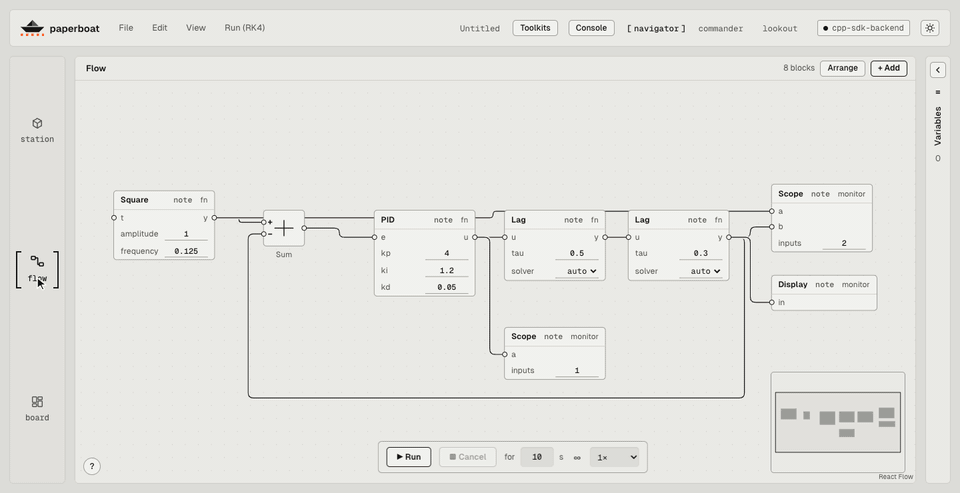
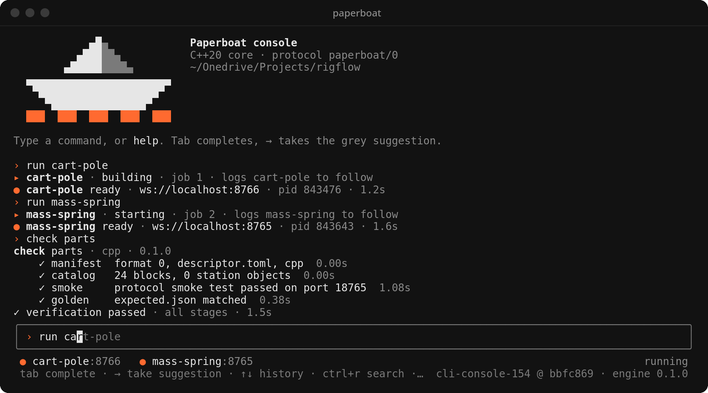
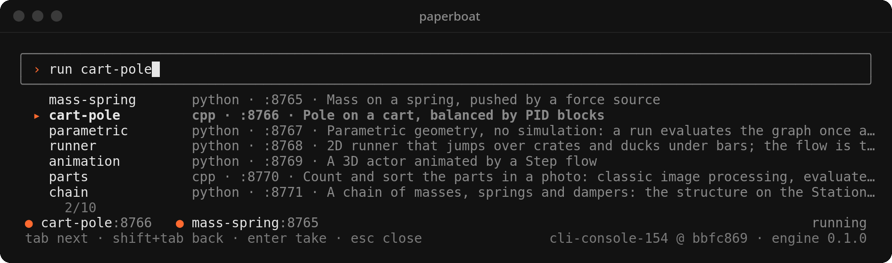
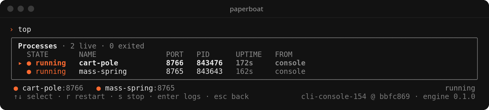

<h1 align="center">
  <picture>
    <source media="(prefers-color-scheme: dark)" srcset=".github/readme/logo-dark.svg">
    
  </picture>
</h1>

<p align="center">A framework for engineering apps: set up a scene, wire a node graph, run it and<br>
watch the results live. Backends are written in C++ or Python; the web UI builds itself from
what they send.<br><br>
📖 <strong>Documentation website: <a href="https://paperboatlab.github.io/paperboat/">https://paperboatlab.github.io/paperboat/</a></strong></p>

<p align="center"></p>

| Check | What it runs | `dev` |
| --- | --- | --- |
| Engine | C++ build and the engine tests | [](https://github.com/paperboatlab/paperboat/actions/workflows/engine.yml?query=branch%3Adev) |
| Python | the bindings and the protocol schema | [](https://github.com/paperboatlab/paperboat/actions/workflows/python.yml?query=branch%3Adev) |
| Web and console | typecheck, tests and build of `apps/web` and `apps/cli` | [](https://github.com/paperboatlab/paperboat/actions/workflows/web.yml?query=branch%3Adev) |
| End to end | the web app in headless Chromium against a real engine backend | [](https://github.com/paperboatlab/paperboat/actions/workflows/e2e.yml?query=branch%3Adev) |
| Journey | the CLI as a user drives it: `bin/paperboat`, the workbench, an example, a toolkit and its example (Linux, Windows, macOS) | [](https://github.com/paperboatlab/paperboat/actions/workflows/journey.yml?query=branch%3Adev) |
| Release | `.deb`, `.rpm`, `.tar.gz`, `.zip` and the npm packages, built on a `v<version>` tag | [](https://github.com/paperboatlab/paperboat/actions/workflows/release.yml) [](https://github.com/paperboatlab/paperboat/releases) |
| Docs | the [API reference](https://paperboatlab.github.io/paperboat/), warnings as errors | [](https://github.com/paperboatlab/paperboat/actions/workflows/docs.yml?query=branch%3Adev) |

On a pull request each workflow runs only when the change can affect it (its `paths`), and the
macOS jobs run on pushes to `dev` and `main` — or on a PR labelled `ci:macos` — so a PR waits on
Linux alone. Everything runs on `dev` and `main`.

## Documentation

Full documentation, guides, and API references are hosted on GitHub Pages:  
👉 **[paperboatlab.github.io/paperboat](https://paperboatlab.github.io/paperboat/)**

- **[User Manual](https://paperboatlab.github.io/paperboat/user_manual.html)** — UI, view modes (Navigator, Commander, Lookout), Station, Flow, and Board
- **[Technical Manual](https://paperboatlab.github.io/paperboat/technical_manual.html)** — Engine architecture, WebSocket protocol (`paperboat/0`), graph scheduling
- **[Tutorials](https://paperboatlab.github.io/paperboat/tutorials.html)** — Step-by-step guides for custom C++ and Python backends
- **[Quickstart](https://paperboatlab.github.io/paperboat/quickstart.html)** — Navigation, controls, and keyboard shortcuts
- **[API Reference](https://paperboatlab.github.io/paperboat/cpp.html)** — C++ SDK, Python SDK, Toolkit, Descriptors, and Protocol

Every app follows one shape:

1. **Setup**: a 2D/3D scene of things, their settings, and how they connect.
2. **Flow**: a node graph (Grasshopper / DaVinci style) that turns the setup into results.
3. **Run**: a 2D monitoring view with progress, live plots, and logs.

First domains: structural analysis, control (cart-pole, double pendulum), and CFD.
No hardware needed. See `docs/plan.html` for the plan.

## Layout

```
apps/web/                 React UI (Vite + TypeScript, React Flow, three.js)
apps/cli/                 the developer console (Ink + TypeScript): drives the paperboat CLI
engine/                   C++20 engine: toolkit (reusable blocks and station objects),
                          core (the generic backend), descriptor loader
python/                   Python bindings for the engine (pip install ./python): write a
                          backend's domain code in Python, the C++ engine runs it
protocol/                 WebSocket protocol spec, JSON Schema, smoke_test.py and golden.py
../paperboat-examples/    example backends, each a project of its own that uses Paperboat
                          (copy one anywhere and it still runs). Not in this repository: they
                          live in paperboat-examples, which is not publicly available; with access,
                          clone it next to this one (or set PAPERBOAT_EXAMPLES_DIR).
                          Ten numbered tutorials, 01–10, from a first clocked Signal flow to
                          vector wires, custom web stations and an acausal Modelica reference:
  01-smart-thermostat-python/  clocked Signal flow, bang-bang heating (Python)
  02-cart-pole-cpp/            a StationObject in code: PID balances a cart-pole (C++)
  03-low-poly-island-python/   evaluated once: procedural terrain and list wires (Python)
  04-cocktail-barista-python/  Step flow: Excel menu, Board Choice, groups, subsystem, E-stop (Python)
  05-rover-lander-python/      custom HTML5 web station, manual vs GNC landing (Python)
  06-robot-pick-place-python/  ABB-style palletizer, IK, quintic trajectories, fork (Python)
  07-airfoil-cfd-python/       D2Q9 lattice-Boltzmann wind tunnel and lift/drag (Python)
  08-air-hockey-tracker-cpp/   optional OpenCV toolkit, HSV→centroid, puck tracking (C++)
  09-modular-synth-cpp/        vector wires [6], six-voice synth, Scope and Speaker (C++)
  10-train-pantograph-cpp/     active pantograph regulator, catenary, arcing (C++/Modelica)
  legacy/                      the nine earlier backends, archived for reference
docs/                     plan, and the API reference (docs/api; live at https://paperboatlab.github.io/paperboat/)
```

The UI has no domain code. The backend sends a block catalog, a scene and a starter
graph; the UI builds the palette, node forms, canvas and 3D view from them (see
`protocol/README.md`). The example backends differ in domain, language, run style
(stepped in time, evaluated once, or interactive), flow type (Signal or Step flow) and
Station view (3D or 2D scene, a graph, the backend's own web page), run on the same UI
unchanged, and all pass the same domain-neutral smoke test and their golden runs.

## Run the proof of concept

The `backend:*` scripts run the example backends, so they need a `paperboat-examples`
checkout (see Layout). Without one, `npm run backend:workbench` serves the standard
toolkits with no domain (the Flow and Dashboard work on their own), and
`engine/tests/sdk-backend` is a backend in this repository:
`./bin/paperboat build engine/tests/sdk-backend && ./bin/paperboat check engine/tests/sdk-backend`.

```sh
pip install websockets
npm install
npm run backend:mass-spring   # ws://localhost:8765
npm run backend:cart-pole     # ws://localhost:8766
npm run backend:parametric    # ws://localhost:8767
npm run backend:runner        # ws://localhost:8768
npm run backend:animation     # ws://localhost:8769
npm run backend:parts         # ws://localhost:8770 (needs OpenCV)
npm run backend:chain         # ws://localhost:8771
npm run backend:supply        # ws://localhost:8772
npm run backend:double-pendulum # ws://localhost:8773
npm run dev                   # http://localhost:3047
```

Or manage backends, toolkits, and the web app with the unified `paperboat` CLI:

```sh
./bin/paperboat start cart-pole     # builds and runs the cart-pole backend (run is the same)
./bin/paperboat list                # everything running, with a KIND: backend or app
./bin/paperboat start               # the web app on 3047, and the workbench backend on 8765
./bin/paperboat examples start      # launches all example backends (ports 8765-8773)
./bin/paperboat run cart-pole       # no paperboat-examples checkout? fetched to ~/.paperboat/examples (PAPERBOAT_EXAMPLES_REPO: another URL), built, run
./bin/paperboat examples fetch     # clone or pull ~/.paperboat/examples
./bin/paperboat examples status     # checks status of example backends
./bin/paperboat toolkit list        # lists available and installed toolkits
./bin/paperboat update --check    # is this checkout (and its app checkouts) behind? `update` pulls and rebuilds
./bin/paperboat deps install <backend>  # an isolated .venv / .julia for its dependencies
./bin/paperboat pkg list            # apps from other repositories (apps.toml): squero-studio-om, ...
./bin/paperboat start squero-studio-om   # a program from apps.toml; fetched and built on first use
./bin/paperboat stop squero-studio-om    # `start` and `stop` take a backend or a program; with no target, the web app
```

### Start a backend of your own

`paperboat new` writes a minimal backend that passes `paperboat check` as it is: one block
(`Scale`) in `domain/`, a starter graph in `descriptor.toml` and the `expected.json` it
matches. The templates are built into the binary, so it works from an installed package too.

```sh
paperboat new my-backend            # C++ (the default), in ./my-backend; --dir <path> for another folder
paperboat new my-backend --python   # Python: needs the paperboat module (npm run build:python, or pip install ./python)
cd my-backend
paperboat build                     # compile it (a Python backend has nothing to compile)
paperboat check                     # manifest, catalog, protocol smoke test, golden run
paperboat run                       # ws://localhost:8790
paperboat start                     # the web app: open http://localhost:3047/?backend=ws://localhost:8790
```

It never overwrites: a folder that exists must be empty. Then add blocks in `domain/`, use
them in the descriptor's `[graph]` and update `expected.json` (docs/api: Quickstart, Testing).

### Apps from other repositories (`pkg`)

`apps.toml` lists the apps that live in their own repositories. `paperboat pkg install <name>[@<version>]`
clones a release tag (default: the newest release, else main, recorded as `dev`) into
`~/.local/share/paperboat/apps` (or `$PAPERBOAT_HOME/apps`) and builds it; `pkg update`, `pkg uninstall`,
`pkg versions` (prereleases too) and `pkg path` do the rest.

paperboat and paperboat-shared share a MAJOR.MINOR line, and `pkg` enforces it. A dep in `apps.toml`
takes a range, `deps = ["paperboat-shared@0.1"]`, and installing the app:

- resolves the dep to its newest tag in that range, prereleases included when the app's own version is a
  prerelease or `dev` (`pkg install squero-studio-om@0.1.0-alpha.1` pulls paperboat-shared `0.1.0-alpha.x`;
  a `dev` app with no tag in range takes the dep's main);
- keeps a dep that is already installed in range, and fails with a clear message when it is outside;
  `--force` reinstalls it in range;
- refuses the other way round too: `pkg install paperboat-shared@0.2.0` fails while an installed app needs
  `0.1` (or pass `--force`), and `pkg update paperboat-shared` stays inside `0.1`;
- records the dep versions in the install marker; `pkg list` shows them under the app, and flags a dep
  installed since that is outside the range.

Versions order by SemVer (`0.1.0-alpha.2 < 0.1.0-alpha.10 < 0.1.0`); `pkg update` and a plain
`pkg install` take releases only, a prerelease only when asked for with `@<version>`. An app installed
from main (`@main`, recorded as `dev`) stays on main through `pkg update`; `@latest` moves it to releases.

### Install

One line, then everything else is `paperboat`:

```sh
curl -fsSL https://raw.githubusercontent.com/paperboatlab/paperboat/HEAD/scripts/install.sh | sh             # newest release, prebuilt
curl -fsSL https://raw.githubusercontent.com/paperboatlab/paperboat/HEAD/scripts/install.sh | sh -s -- --main  # the dev branch, built from source
```

It installs into `~/.local/share/paperboat` (or `$PAPERBOAT_HOME`) and links `~/.local/bin/paperboat`.
Three channels: `release` (the default: the newest GitHub release's `.tar.gz`, prereleases included),
`source` (that release built from source, so toolkits install) and `main` (the default branch, built from
source; needs git, cmake, a C++20 compiler and Node.js 22). Then:

```sh
paperboat update --check                 # paperboat, the apps and toolkits: what is behind
paperboat update                         # update each along its channel, and rebuild what changed
paperboat update --channel main          # switch paperboat itself (release | source | main)
paperboat pkg install squero-studio-mx   # an app, at its newest release; @main tracks main, @latest goes back
paperboat toolkit install optimization   # a toolkit (source and main channels), same @main / @latest
```

An app or toolkit stays on the channel it was installed on: `update` moves a release to the newest
release and a `main` install to the newest commit of main.

Or from a package (these update with the package manager, or `paperboat update --channel release` moves
to the per-user install above):

```sh
npm install -g @paperboatlabs/cli        # Linux x64, macOS arm64 (Apple Silicon) and Windows x64. The native binary is an optional dependency
sudo apt install ./paperboat_<version>_amd64.deb   # Debian / Ubuntu, from the GitHub release
sudo dnf install ./paperboat-<version>.x86_64.rpm  # Fedora / RHEL
tar xzf paperboat-<version>-Darwin-arm64.tar.gz      # macOS 13+ on Apple Silicon, from the GitHub release
Expand-Archive paperboat-<version>-Windows-AMD64.zip  # Windows x64 (PowerShell), from the GitHub release
```

A package install is the CLI and the apps: `paperboat` opens the console (needs `node`),
`paperboat start` serves the web app on http://localhost:3047 (no npm, no checkout), and `pkg`,
`update`, `check`, `pack`. Building C++ backends
and installing toolkits (they compile into the engine) need paperboat built from source.
Python backends run through the CLI as they are: every package ships the `paperboat` module
(in `lib/paperboat/python`, which `paperboat run`/`check` put on `PYTHONPATH`) for CPython 3.11
and later; the CLI runs `python3`, or the backend's `.venv`, or `$PAPERBOAT_PYTHON`. A process
started another way needs the wheel: `pip install paperboat-<version>-cp312-abi3-<platform>.whl`
(Python 3.12+).

### The console

`./bin/paperboat` with no command opens the full-screen console: run, build and check
backends without leaving the prompt. The mark at the top rides its water while work is
live, the transcript scrolls under it (PgUp/PgDn; quitting gives the terminal back as it
was), and the bar at the bottom shows what is live. Backends run as background jobs, Tab
completes commands, backends and paths, and → takes the grey suggestion from history. In a
script or a pipe, `paperboat` stays the plain CLI. Build it once with
`npm install && npm run build:cli`; see [the quickstart](https://paperboatlab.github.io/paperboat/quickstart.html) for the keys.



Tab opens a menu with each backend's language, port and description; `top` lists every
running backend to restart, stop or follow its log; `about` shows the console and engine
versions and what is installed.




The UI opens on the mass-spring backend. To switch, type another backend's URL in the
header and press **Connect**: the palette, canvas and scene change to that domain, and
**Run** runs its starter graph.

Check any backend against the protocol with `npm run smoke -- 8767` (any port), and
every example's starter result with `npm run golden`.
